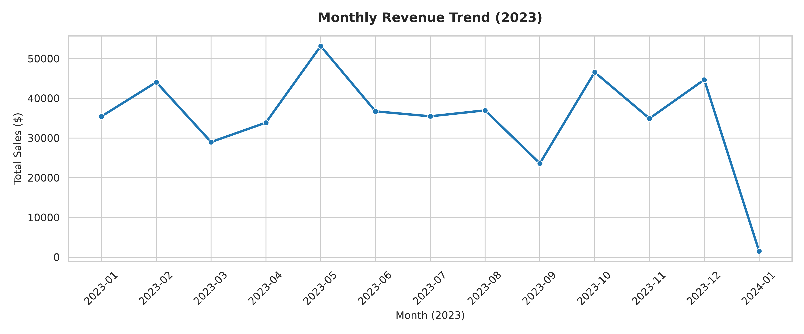
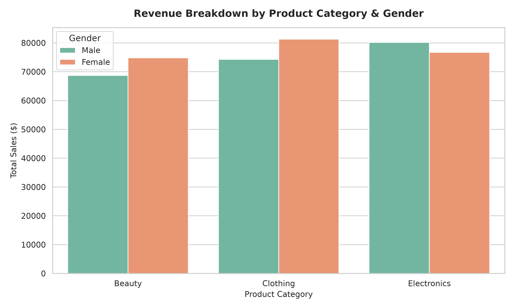

# Retail Sales Exploratory Data Analysis (Synthetic Dataset)

A practice project in data analysis with Python: exploring a dataset of 1,000 retail transactions to compute key indicators, track monthly revenue and compare product categories by customer gender.

> **Please note:** the data is **synthetic** (generated for learning purposes, not from a real company). The results below illustrate an analytical approach and say nothing about a real market.

## Objectives

- Practice loading, checking and preparing data with Pandas and NumPy.
- Compute key indicators: total revenue, number of transactions, average basket, average customer age.
- Measure monthly revenue trends and spot possible seasonal peaks.
- Compare revenue by product category and by gender.

## Data

- **File:** `retail_sales_dataset.csv`
- **Source:** the "Retail Sales Dataset" published on Kaggle by Mohammad Talib and described as synthetic: <https://www.kaggle.com/datasets/mohammadtalib786/retail-sales-dataset>
- **Content:** 1,000 transactions, 9 columns: transaction ID, date, customer ID, gender, age, product category (Beauty, Clothing, Electronics), quantity, price per unit, total amount.
- **Period covered:** from January 2023 to early January 2024 (January 2024 contains almost no sales, which suggests an incomplete month).
- **Location:** the file is not included in this repository. Download it from Kaggle and place it next to the notebook, at the root.

## Method

1. **Loading and inspection** (`read_csv`, `head`, `info`): 1,000 rows, 9 columns, no missing values. The `Date` column is read as text.
2. **Cleaning and preparation**: converting `Date` to a date type, checking for duplicates (0 duplicated rows), creating a year-month variable for monthly aggregation.
3. **Key indicators**: total revenue, number of transactions, average basket, average age.
4. **Visualization** with Matplotlib and Seaborn: monthly revenue trend, revenue by category and by gender.

Full details are in the notebook `data-analysis.ipynb`.

## Tools

- Python 3 (run with Python 3.9)
- Pandas 2.3.3 and NumPy 2.0.2 (loading, cleaning, computations)
- Matplotlib 3.9.4 and Seaborn 0.13.2 (visualization)
- Jupyter Notebook

## Key indicators

| Indicator | Value |
|---|---|
| Total revenue | $456,000 |
| Number of transactions | 1,000 |
| Average basket | $456 |
| Average customer age | 41.4 years |

## Visualizations

### 1. Monthly revenue trend

Month-by-month revenue to spot possible peaks or drops.

### 2. Revenue by product category and gender

Comparison of revenue across the three categories (Beauty, Clothing, Electronics) by customer gender.

## Key findings

The values below are read from the charts and rounded: they are indicative.

- **Seasonality:** monthly revenue ranges from about $23,000 (September 2023) to about $53,000 (May 2023, the peak of the period). February, October and December are also high (about $44,000 to $47,000). No clear underlying trend emerges. January 2024 (about $1,500) is a very incomplete month and should not be compared with the others.
- **Categories:** the split is fairly balanced. Electronics (about $157,000, 34% of the total) and Clothing (about $155,000, 34%) are slightly ahead of Beauty (about $143,000, 31%).
- **Gender:** women lead in Beauty and Clothing, men in Electronics. The gaps are modest (a few thousand dollars) and were not tested statistically.

## Limitations

- **Synthetic data:** it was generated artificially. Small gaps between categories or genders may come from how the data was generated, not from real customer behavior.
- **Small size:** only 1,000 transactions, which limits how far month-by-month comparisons can be trusted.
- **Incomplete period:** the last month (January 2024) is almost empty.
- **Descriptive analysis:** the project describes the data but does not establish cause and effect and does not try to predict anything.
- **No link to a real product catalog:** only three very broad categories, with no detailed product attributes.

## Next steps

- Analyze the age distribution (histogram) and cross age with categories.
- Add statistical tests to see whether the observed differences between categories and genders are significant.
- Exclude or flag the incomplete month in the charts.
- Apply the same approach to real data, starting with a quality check (missing values, duplicates, inconsistencies).
- Automate the computations in a script or a re-runnable pipeline.

## Reproducing the analysis

1. Clone the repository.
2. Install the dependencies: `pip install pandas numpy matplotlib seaborn jupyter`.
3. Download `retail_sales_dataset.csv` from Kaggle and place it at the root, next to the notebook.
4. Create the `visuals/` folder if it does not exist (the notebook saves the charts there).
5. Open `data-analysis.ipynb` and run the cells from top to bottom.

